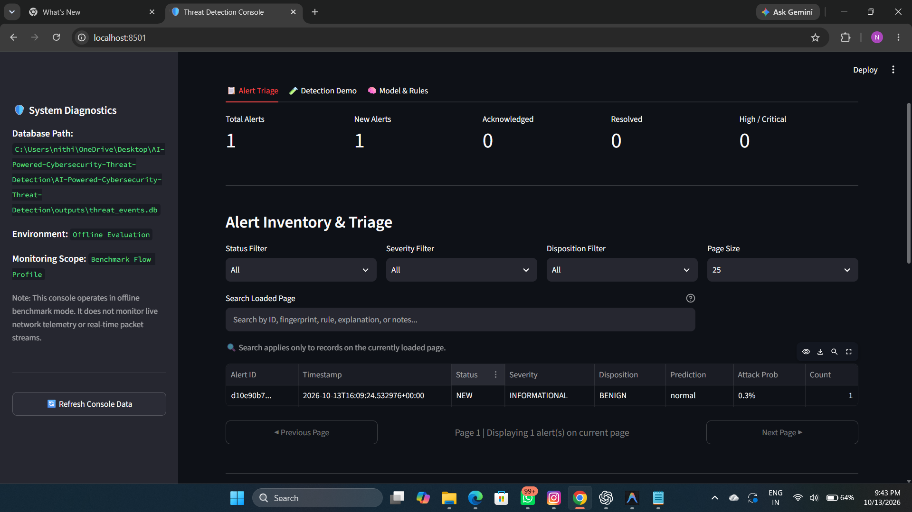
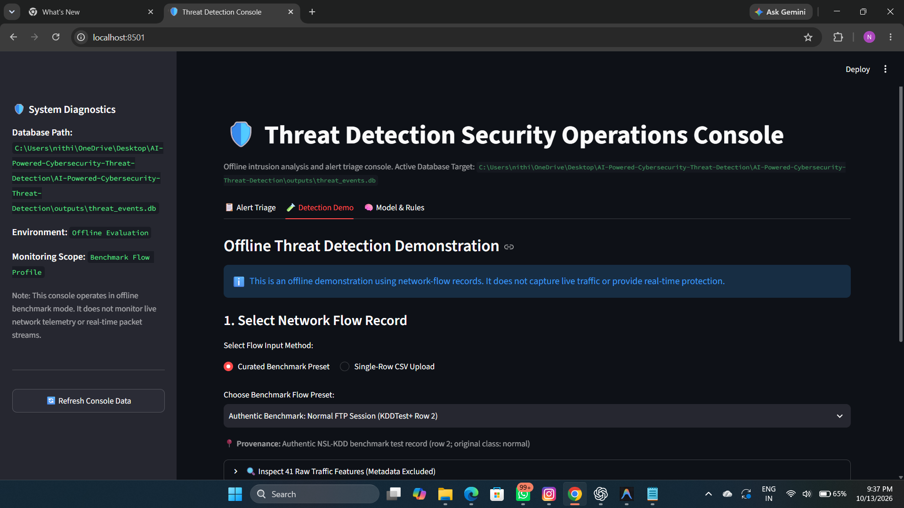
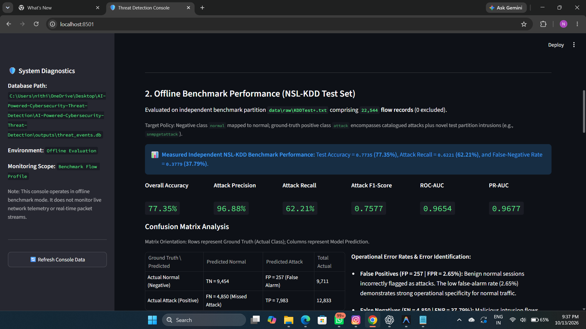
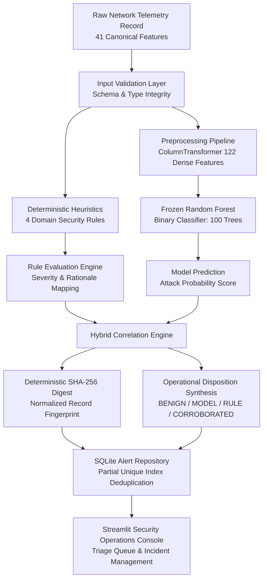

# AI-Powered Cybersecurity Threat Detection System

An offline, defensive cybersecurity threat detection prototype and security operations triage console designed to evaluate network flow telemetry, detect structural anomalies, and demonstrate hybrid machine learning and heuristic rule-based detection using the NSL-KDD benchmark dataset.

---

## 1. Executive Summary and Problem Statement

### 1.1 The Operational Challenge
Modern Security Operations Centers (SOCs) face two chronic challenges when analyzing network traffic telemetry:
1. **Signature Rigidity:** Traditional intrusion detection systems (IDS) depend on deterministic signatures. While these rules provide zero false positives on known exploits, they fail against subtle structural anomalies, zero-day variations, and polymorphic traffic patterns.
2. **Black-Box Alert Fatigue:** Standalone machine learning models can detect novel statistical anomalies, but they frequently generate unacceptable false-alarm rates and lack transparent rationale, forcing security analysts to waste critical triage time investigating false positives.

### 1.2 The Defensive Solution
This project implements a modular, hybrid threat detection architecture designed for educational research, security operations triage demonstration, and offline network telemetry analysis. The architecture combines:
* **Statistical Machine Learning:** A frozen Random Forest binary classifier trained on canonical network flow features to compute attack probabilities.
* **Deterministic Heuristic Rules:** Domain-specific security rules targeting concrete network anomalies such as LAND topology attacks, SYN flood bursts, connection rejection hammering, and horizontal port sweeps.
* **Hybrid Correlation Engine:** A decision synthesis layer that merges statistical model outputs with deterministic rule triggers into standardized triage dispositions: `BENIGN`, `MODEL_DETECTED`, `RULE_DETECTED`, and `CORROBORATED`.
* **Deduplication-Aware Incident Persistence:** An ACID-compliant SQLite repository utilizing partial unique indexes to automatically deduplicate active alerts by deterministic flow fingerprint and enforce strict incident lifecycle progression (`NEW` -> `ACKNOWLEDGED` -> `RESOLVED`).
* **Security Operations Console:** An interactive Streamlit console featuring an Alert Triage queue, an offline Detection Demonstration sandbox, and a Model and Rules technical specification viewer.

```text
+--------------------------------------------------------------------------------------------------+
|                                    DEFENSIVE AND EDUCATIONAL SCOPE NOTICE                        |
|                                                                                                  |
| This system is designed exclusively for educational research, benchmarking, and defensive triage |
| demonstrations. It evaluates static network flow records from public benchmark data. It does not |
| capture live network packets, monitor stream interfaces, perform inline traffic blocking, or     |
| provide production enterprise network protection.                                                |
+--------------------------------------------------------------------------------------------------+
```

---

## 2. Visual Overview and Interface Gallery

The user interface is organized into three dedicated operational consoles in Streamlit. Below are direct references to the visual assets maintained in the repository:

### 2.1 System Architecture Flow

*High-level data flow illustrating telemetry ingestion, feature preprocessing, parallel model and rule evaluation, SHA-256 fingerprinting, alert deduplication, and triage presentation.*

### 2.2 Security Operations Console: Alert Triage Queue

*The primary analyst console displaying real-time KPI metrics, active incident filtering by status and severity, free-text search, and explicit two-step lifecycle state controls.*

### 2.3 Detection Demonstration Sandbox

*Interactive testing sandbox allowing analysts to evaluate curated NSL-KDD attack presets or upload single-row CSV records with immediate side-by-side ML scoring and heuristic rule diagnostics.*

### 2.4 Model and Rules Technical Specifications

*Complete architectural documentation tab showcasing confusion matrix breakdowns, false-positive metrics, ROC-AUC performance curves, and deterministic rule criteria.*

*(Note: Image files are maintained in the `images/` directory. If screenshots are pending upload, please refer to the technical diagrams and CLI output logs below).*

---

## 3. System Architecture and Methodology

The system processes 41-feature network telemetry records through a sequential, leakage-resistant pipeline:



### 3.1 Data Flow Specifications
1. **Telemetry Input:** Receives a 41-feature network session record in dictionary, Pandas Series, or CSV format.
2. **Schema Audit:** Verifies the presence of all 41 canonical features, validates categorical values (`protocol_type`, `service`, `flag`), and checks numerical ranges.
3. **Feature Preprocessing:** Encodes the 3 categorical variables into 84 binary indicators via `OneHotEncoder(handle_unknown='ignore')` and passes the 38 numerical features through directly, producing exactly 122 dense features with zero imputation and zero data scaling.
4. **Parallel Evaluation:**
   * The Random Forest classifier computes an attack probability and binary label (`normal` vs `attack`).
   * The heuristic rule engine checks four deterministic security rules.
5. **Correlation and Fingerprinting:**
   * Computes a canonical SHA-256 fingerprint over the 41 feature name-value pairs.
   * Synthesizes findings into a final triage disposition and composite severity.
6. **Persistence and Triage:**
   * Inserts or updates an alert record in SQLite.
   * If an active alert (`NEW` or `ACKNOWLEDGED`) with the same fingerprint exists, the system increments `occurrence_count`, updates timestamps, and maintains the highest severity without duplicate rows.

---

## 4. Detection Engine and Security Rules

### 4.1 Hybrid Triage Dispositions

| Operational Disposition | Definition and Operational Criteria | Recommended SOC Action |
| :--- | :--- | :--- |
| **BENIGN** | Model predicts normal traffic and zero heuristic security rules trigger. | No alert generated; telemetry logged for baseline auditing. |
| **MODEL_DETECTED** | Random Forest flags suspicious statistical patterns; no heuristic rules match. | Standard Priority Triage: Analyst investigates feature anomalies. |
| **RULE_DETECTED** | A deterministic heuristic security rule triggers; Random Forest scores below threshold. | High Priority Triage: Known exploit pattern identified. |
| **CORROBORATED** | Both the statistical model and one or more heuristic rules flag the record. | Critical Immediate Triage: High-confidence threat corroboration. |

### 4.2 Deterministic Heuristic Security Rules

The engine implements four explainable security rules designed to capture well-documented network attack patterns:

#### RULE-LAND-001: Self-Referential Connection (LAND Attack)
* **Severity:** `HIGH`
* **Condition:** `land == 1`
* **Technical Description:** Detects spoofed packets where source IP and destination IP (or ports) are identical, designed to cause denial of service by forcing a host to respond to itself.

#### RULE-DOS-SYN-001: High-Volume Unestablished SYN Burst (SYN Flood)
* **Severity:** `MEDIUM`
* **Condition:** `count >= 100` AND `serror_rate >= 0.80` AND `flag in {'S0', 'S1', 'S2', 'S3', 'RSTOS0'}`
* **Technical Description:** Identifies denial of service attacks characterized by high rates of unanswered TCP SYN connection attempts with elevated SYN-error ratios.

#### RULE-DOS-REJ-001: Repeated Connection Rejection Hammering (REJ Flood)
* **Severity:** `MEDIUM`
* **Condition:** `count >= 50` AND `rerror_rate >= 0.80` AND `flag in {'REJ', 'RSTO', 'RSTR'}`
* **Technical Description:** Detects brute-force connection hammering resulting in high rates of immediate server connection rejections (RST/REJ).

#### RULE-PROBE-SCAN-001: Multi-Service Port Sweep (Reconnaissance Probe)
* **Severity:** `MEDIUM`
* **Condition:** `count >= 50` AND `diff_srv_rate >= 0.70` AND `dst_host_diff_srv_rate >= 0.70`
* **Technical Description:** Identifies horizontal and vertical port scanning behavior where a single source probes diverse destination ports and services.

---

## 5. Persistent Alert Storage and Incident Lifecycle

The alert repository provides ACID-compliant storage via SQLite, implementing defense-in-depth principles for alert management:

### 5.1 Deduplication on Active Fingerprints
To prevent SOC alert fatigue, the storage layer implements a SQLite partial unique index:
```sql
CREATE UNIQUE INDEX idx_alerts_active_fingerprint
ON alert_records (record_fingerprint)
WHERE status IN ('NEW', 'ACKNOWLEDGED');
```
* When an active alert (`NEW` or `ACKNOWLEDGED`) already exists for a given network flow fingerprint, subsequent observations do not create new rows.
* The repository automatically increments `occurrence_count`, updates `last_seen_timestamp`, appends rule triggers, and retains the highest observed severity.
* When an alert is marked `RESOLVED`, the fingerprint is cleared from the active partial index. Future occurrences of that pattern will cleanly spawn a new alert.

### 5.2 Strict Lifecycle State Machine
Incident progression follows an auditable two-step lifecycle state machine:
```text
[ NEW ] --------> [ ACKNOWLEDGED ] --------> [ RESOLVED ]
```
* **NEW to ACKNOWLEDGED:** Analyst confirms ownership and begins investigation.
* **ACKNOWLEDGED to RESOLVED:** Analyst applies remediation or verifies false positive, requiring mandatory analyst notes.
* **Direct NEW to RESOLVED:** Strictly rejected with `InvalidStateTransitionError` to ensure every resolved incident has an accountable investigation trail.
* **Post-Resolution Mutation:** Resolved alerts are immutable; transitions from `RESOLVED` back to earlier states are rejected.

---

## 6. Model Evaluation and Empirical Benchmark Results

The frozen Random Forest binary classifier was evaluated on the independent NSL-KDD test partition (`data/raw/KDDTest+.txt`), comprising **22,544 flow records** (0 records excluded). Telemetry was computed using `threat_detection.detection.evaluator` and verified against `outputs/evaluation_metrics.json`.

### 6.1 Performance Summary Metrics

| Evaluation Metric | Measured Value | Percentage | Operational Significance |
| :--- | :---: | :---: | :--- |
| **Overall Accuracy** | `0.7735` | **77.35%** | Correct classifications across all normal and attack flows |
| **Attack Precision** | `0.9688` | **96.88%** | High reliability: 96.88% of model-flagged attacks are genuine |
| **Attack Recall (Detection Rate)** | `0.6221` | **62.21%** | Proportion of ground-truth attacks identified by the model |
| **Attack F1-Score** | `0.7577` | 75.77% | Harmonic mean of attack precision and attack recall |
| **False-Positive Rate (FPR)** | `0.0265` | **2.65%** | Exceptionally low false-alarm rate on benign baseline traffic |
| **False-Negative Rate (FNR)** | `0.3779` | **37.79%** | Rate of missed attacks primarily driven by novel test variants |
| **Normal Class Precision** | `0.6609` | **66.09%** | Accuracy when identifying benign network traffic |
| **Normal Class Recall** | `0.9735` | **97.35%** | High fidelity: 97.35% of normal sessions correctly cleared |
| **Area Under ROC Curve (ROC-AUC)** | `0.9654` | 96.54% | Strong discriminative ability across discrimination thresholds |
| **Precision-Recall AUC (PR-AUC)** | `0.9677` | 96.77% | Area under the precision-recall curve for the attack class |

### 6.2 Confusion Matrix Breakdown

Orientation: Rows represent Ground Truth (Actual Class); Columns represent Model Prediction.

| Ground Truth \ Predicted | Predicted Normal (Negative) | Predicted Attack (Positive) | Actual Total |
| :--- | :---: | :---: | :---: |
| **Actual Normal (Negative)** | **TN = 9,454** *(True Clean)* | **FP = 257** *(False Alarm)* | **9,711** |
| **Actual Attack (Positive)** | **FN = 4,850** *(Missed Threat)* | **TP = 7,983** *(Detected Threat)* | **12,833** |
| **Predicted Total** | **14,304** | **8,240** | **22,544** |

### 6.3 Technical Error Analysis and Evaluation Policy
1. **Low False Alarm Burden (FPR = 2.65%):** Out of 9,711 normal network flows in the benchmark test set, only 257 were flagged as false alarms. This high specificity protects security analysts from excessive triage volume.
2. **Impact of Novel Attack Distribution (FNR = 37.79%):** The NSL-KDD test dataset intentionally includes 17 novel attack types that do not exist in the training dataset (such as `apache2`, `httptunnel`, `mailbomb`, `mscan`, `processtable`, `ps`, `saint`, and `udpstorm`). The false-negative rate illustrates the real-world limitation of static supervised learning when facing zero-day attack variations without continuous online retraining.
3. **Ground-Truth Policy for Uncatalogued Attacks:** The benchmark test set contains 178 records labeled with `snmpgetattack`, an attack identifier not documented in the original training taxonomy. Under the system's evaluation policy (`on_unknown="attack"`), uncatalogued labels are mapped to the ground-truth `attack` class for evaluation scoring so that novel intrusions are evaluated as actual threats. This is an evaluation ground-truth assignment, not a model prediction override; model inference relies strictly on the 41 network flow features.

---

## 7. Technology Stack

* **Programming Language:** Python 3.9+ (Verified on Python 3.13)
* **Data Engineering and Preprocessing:** Pandas, NumPy, Scikit-Learn (`ColumnTransformer`, `OneHotEncoder`)
* **Machine Learning and Inference:** Scikit-Learn (`RandomForestClassifier`), Joblib
* **Data Storage and Persistence:** SQLite (Embedded relational storage with transaction control and partial unique indexes)
* **Web Application Framework:** Streamlit (Multi-tab security operations console)
* **Visualization and Charting:** Matplotlib, Seaborn
* **Automated Testing:** Pytest (155 automated unit and end-to-end integration tests)
* **Configuration Management:** Python Dotenv, TOML (`pyproject.toml`)

---

## 8. Repository Layout

```text
AI-Powered-Cybersecurity-Threat-Detection/
|-- .github/
|   `-- workflows/
|       `-- ci.yml                  # GitHub Actions continuous integration workflow
|-- dashboard/
|   |-- app.py                      # Multi-tab Streamlit console (Triage, Demo, Model & Rules)
|   `-- helpers.py                  # Dashboard business logic, KPIs, presets, and formatting
|-- data/
|   |-- raw/                        # Directory for public NSL-KDD raw datasets (git-ignored)
|   |-- processed/                  # Directory for preprocessed intermediate data (git-ignored)
|   `-- sample/                     # Synthetic test telemetry fixtures
|-- docs/
|   |-- 01_architecture_and_system_design.md
|   |-- 02_dataset_and_preprocessing.md
|   |-- 03_exploratory_data_analysis.md
|   |-- 04_model_training_and_learning.md
|   |-- 05_validation_and_testing_guide.md
|   |-- 06_threat_detection_engine.md
|   |-- 07_alert_management_and_database.md
|   |-- 08_dashboard_and_operations_guide.md
|   |-- 09_end_to_end_integration.md
|   |-- 10_portfolio_and_packaging_guide.md
|   `-- evidence/                   # 11 engineering evidence reports and quality gate audits
|-- images/                         # Screenshot gallery and system architecture diagrams
|   |-- .gitkeep
|   `-- README.md
|-- models/                         # Serialized model weights and training metadata (git-ignored)
|   `-- .gitkeep
|-- outputs/
|   |-- evaluation_metrics.json     # Precomputed benchmark test metrics and confusion matrix
|   |-- figures/                    # Exported visualization figures
|   |-- logs/                       # Application runtime logs
|   `-- reports/                    # Generated evaluation reports
|-- src/
|   `-- threat_detection/
|       |-- __init__.py             # Package exports and semantic versioning
|       |-- config.py               # Central project path and threshold configuration
|       |-- data/                   # NSL-KDD schema definitions, loaders, and validator CLI
|       |-- detection/              # Random Forest trainer, inference engine, evaluation CLI, rules
|       |-- preprocessing/          # Scikit-Learn ColumnTransformer pipeline
|       `-- storage/                # SQLite alert persistence and lifecycle state machine
|-- tests/                          # 11 test modules with 155 automated unit and E2E tests
|-- .env.example                    # Environment variable configuration template
|-- .gitignore                      # Git exclusion rules for venvs, datasets, DBs, and weights
|-- LICENSE                         # MIT License attribution
|-- main.py                         # Application foundation entry point
|-- pyproject.toml                  # Modern setuptools packaging configuration
`-- requirements.txt                # Pinned development and runtime dependencies
```

---

## 9. Installation and Quickstart Guide

### 9.1 Prerequisites
* Operating System: Windows 10/11, macOS, or Linux
* Python: Version 3.9 through 3.13 installed and available on PATH
* Git: Version 2.30+ installed

### 9.2 Clone the Repository
Open a terminal (or PowerShell on Windows) and clone the repository:
```powershell
git clone https://github.com/nithinraam25/AI-Powered-Cybersecurity-Threat-Detection.git
cd AI-Powered-Cybersecurity-Threat-Detection
```

### 9.3 Create and Activate a Virtual Environment
```powershell
python -m venv .venv
.\.venv\Scripts\Activate.ps1
```
*(On Linux or macOS, use: `source .venv/bin/activate`)*

### 9.4 Install Project Dependencies
Upgrade pip and install requirements along with an editable package install:
```powershell
python -m pip install --upgrade pip
pip install -r requirements.txt
pip install -e ".[dev]"
```

### 9.5 Configure Environment Variables
Copy the provided `.env.example` template to `.env`:
```powershell
Copy-Item .env.example .env
```
*(On Linux or macOS, use: `cp .env.example .env`)*

The system functions with secure default configurations. Review `.env` if you wish to adjust SQLite paths or custom score thresholds.

---

## 10. Verification and Automated Testing

The project maintains 100% test coverage across 155 automated unit and end-to-end integration tests:

### 10.1 Run the Full Test Suite
Execute pytest across all test modules:
```powershell
.\.venv\Scripts\python.exe -m pytest -v
```
*Expected Result: 155 passed, 0 failed, 0 warnings in approximately 20 seconds.*

### 10.2 Run Focused Subsystem Test Suites

```powershell
# Run End-to-End Integration Tests
.\.venv\Scripts\python.exe -m pytest tests/test_integration_e2e.py -v

# Run Alert Repository & Deduplication Tests
.\.venv\Scripts\python.exe -m pytest tests/test_alert_storage.py -v

# Run Threat Detection Engine & Rule Tests
.\.venv\Scripts\python.exe -m pytest tests/test_detection_engine.py -v

# Run Streamlit Console Logic & Helper Tests
.\.venv\Scripts\python.exe -m pytest tests/test_dashboard.py tests/test_dashboard_demo.py -v
```

---

## 11. Running the Security Operations Console

Launch the interactive Streamlit dashboard:
```powershell
.\.venv\Scripts\streamlit run dashboard/app.py
```
The dashboard will open automatically in your browser at `http://localhost:8501`.

### Console Features
1. **Alert Triage Console:**
   * View total alerts, active investigations, corroborated incidents, and critical severity metrics.
   * Filter alerts by Status (`NEW`, `ACKNOWLEDGED`, `RESOLVED`) and Severity (`INFORMATIONAL`, `MEDIUM`, `HIGH`).
   * Inspect individual flow fingerprints, model probability scores, and triggered security rules.
   * Progress alerts through the lifecycle state machine with mandatory analyst audit notes.
2. **Detection Demonstration Sandbox:**
   * Load pre-configured telemetry presets representing clean web traffic, DNS traffic, SYN flood bursts, and port scans.
   * Alternatively, upload a single-row CSV flow record to evaluate custom network telemetry.
   * View live ML attack probability gauge, heuristic rule triggers, and hybrid triage disposition.
   * Optionally persist newly detected incidents into the active SQLite database with deduplication.
3. **Model and Rules Technical Specification:**
   * Review precomputed benchmark confusion matrices and performance metrics.
   * Inspect feature transformation dimensions (122 dense features).
   * Review exact rule criteria, severities, and rationales for all four security rules.

To terminate the dashboard, press `Ctrl + C` in your terminal.

---

## 12. Command-Line Interface (CLI) Tools

### 12.1 Dataset Validation CLI
Audits NSL-KDD dataset files for column counts, null values, duplicate rows, and attack family distributions:
```powershell
# Validate default training set (data/raw/KDDTrain+.txt)
.\.venv\Scripts\python.exe -m threat_detection.data.cli

# Validate test benchmark partition with explicit schema variant check
.\.venv\Scripts\python.exe -m threat_detection.data.cli data/raw/KDDTest+.txt --variant with_difficulty_43
```

### 12.2 Offline Model Evaluation CLI
Evaluates the frozen Random Forest classifier against a test dataset without retraining or modifying model weights:
```powershell
# Evaluate model against KDDTest+ and display summary metrics
.\.venv\Scripts\python.exe -m threat_detection.detection.evaluate_cli data/raw/KDDTest+.txt

# Evaluate and export complete telemetry to a JSON report
.\.venv\Scripts\python.exe -m threat_detection.detection.evaluate_cli data/raw/KDDTest+.txt --json-output outputs/evaluation_metrics.json
```

---

## 13. Scope, Ethical Considerations, and Limitations

1. **Defensive and Research Orientation:** This software was designed exclusively for academic study, defensive triage research, and security portfolio demonstration.
2. **Offline Telemetry vs. Live Traffic:** Telemetry records evaluated by this system represent aggregated connection flows rather than raw network packets. The system does not listen on physical network interfaces or sniff live network packets.
3. **Advisory Decision Support:** The engine serves as an analytical assistant for security analysts. It does not perform inline firewall blocking, packet dropping, or automated host isolation.
4. **Benchmark Generalization:** The NSL-KDD dataset is derived from academic benchmark collections. Its feature distributions do not capture modern encrypted application layers (such as TLS 1.3 or QUIC) or contemporary cloud-native attack vectors.

---

## 14. License and Attribution

* **Source Code License:** Released under the [MIT License](LICENSE). Copyright (c) 2026 nithinraam25.
* **Third-Party Dependencies:** Third-party libraries (Scikit-Learn, Pandas, NumPy, Streamlit, Pytest, Joblib) remain subject to their respective open-source licenses.
* **Dataset Attribution:** The NSL-KDD dataset was developed by the Information Security Centre of Excellence (ISCX) at the University of New Brunswick (UNB).
