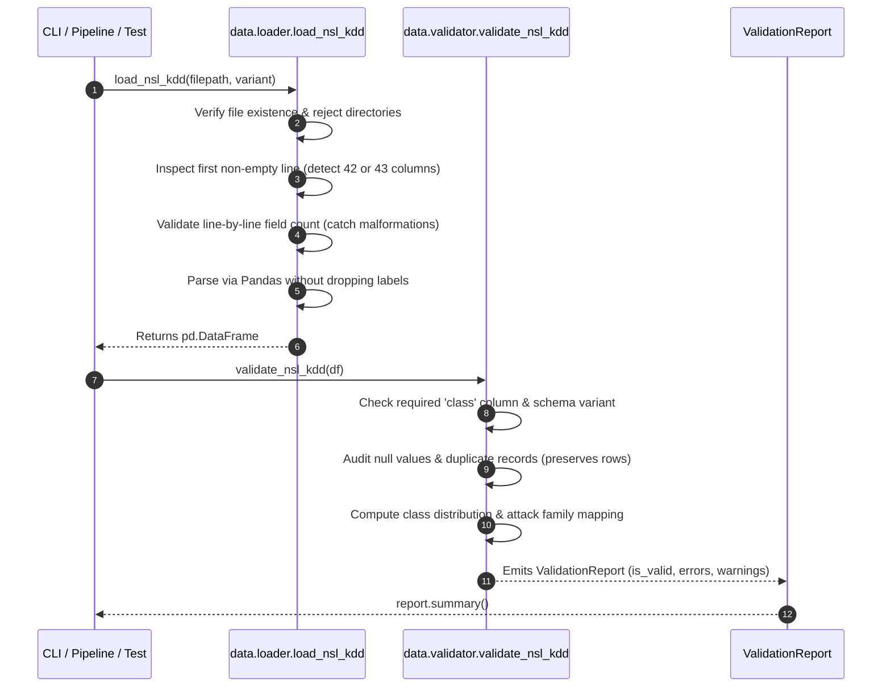

# 02. Dataset & Data Flow

## 1. Dataset Selection: NSL-KDD Benchmark

The **AI-Powered Cybersecurity Threat Detection System** utilizes the **NSL-KDD** benchmark intrusion detection dataset to train and validate its models.

### 1.1 Purpose of NSL-KDD
NSL-KDD is an improved, deduplicated refinement of the landmark KDD Cup 1999 dataset produced by the University of New Brunswick (UNB). It addresses several fundamental flaws in KDD Cup 99:
1. **Redundancy Elimination**: Eliminates massive record duplication in the train and test partitions, preventing learning algorithms from being biased toward frequent normal/DoS patterns.
2. **Realistic Proportions**: Balances the ratio of normal vs. attack flows across varying difficulty levels.
3. **Reproducibility**: Provides standardized train (`KDDTrain+`) and test (`KDDTest+`) splits recognized globally across academic and enterprise intrusion detection benchmarks.

### 1.2 Recognized Acquisition Sources
- **Primary Research Authority**: University of New Brunswick (UNB), Canadian Institute for Cybersecurity (CIC).<br>
  Official reference portal: `https://www.unb.ca/cic/datasets/nsl.html`
- **Expected Offline Locations**:
  - Training Set: `data/raw/KDDTrain+.txt` (or `KDDTrain+_20Percent.txt`)
  - Testing Set: `data/raw/KDDTest+.txt` (or `KDDTest-21.txt`)

> [!NOTE]
> The system operates in an offline, local validation mode during this phase. It never downloads files automatically over the network or captures live packet traffic on host interfaces.

---

## 2. NSL-KDD Input Schema Contract

The loader supports two distinct schema variants:

| Variant Name | Column Count | Structure | Typical Files |
| :--- | :---: | :--- | :--- |
| `standard_42` | 42 | 41 Traffic Features + 1 Class Label | Legacy preprocessed KDD/NSL-KDD files |
| `with_difficulty_43` | 43 | 41 Traffic Features + 1 Class Label + 1 Difficulty Score | Canonical `KDDTrain+.txt`, `KDDTest+.txt` |

### 2.1 The 41 Traffic Features
1. **Basic Flow Identifiers**: `duration`, `protocol_type` (tcp, udp, icmp), `service` (http, smtp, ftp, etc.), `flag` (SF, S0, REJ, etc.), `src_bytes`, `dst_bytes`, `land`, `wrong_fragment`, `urgent`.
2. **Content Features**: `hot`, `num_failed_logins`, `logged_in`, `num_compromised`, `root_shell`, `su_attempted`, `num_root`, `num_file_creations`, `num_shells`, `num_access_files`, `num_outbound_cmds`, `is_host_login`, `is_guest_login`.
3. **Time-based Traffic Features**: `count`, `srv_count`, `serror_rate`, `srv_serror_rate`, `rerror_rate`, `srv_rerror_rate`, `same_srv_rate`, `diff_srv_rate`, `srv_diff_host_rate`.
4. **Host-based Traffic Features**: `dst_host_count`, `dst_host_srv_count`, `dst_host_same_srv_rate`, `dst_host_diff_srv_rate`, `dst_host_same_src_port_rate`, `dst_host_srv_diff_host_rate`, `dst_host_serror_rate`, `dst_host_srv_serror_rate`, `dst_host_rerror_rate`, `dst_host_srv_rerror_rate`.

### 2.2 Target Class & Difficulty Columns
- Column 42 (`class`): Canonical attack name (e.g., `normal`, `neptune`, `smurf`, `satan`, `ipsweep`, `guess_passwd`, `buffer_overflow`).
- Column 43 (`difficulty_level`): An integer difficulty rating from $0$ (hardest to detect) to $21$ (easiest to detect).

### 2.3 Attack Family Taxonomy
The loader associates specific attack types with 4 primary attack vectors:
- **DoS (Denial of Service)**: `apache2`, `back`, `land`, `mailbomb`, `neptune`, `pod`, `processtable`, `smurf`, `teardrop`, `udpstorm`
- **Probe (Port scanning / Surveillance)**: `ipsweep`, `mscan`, `nmap`, `portsweep`, `saint`, `satan`
- **R2L (Remote to Local exploitation)**: `ftp_write`, `guess_passwd`, `httptunnel`, `imap`, `multihop`, `named`, `phf`, `sendmail`, `snmpget`, `snmpguess`, `spy`, `warezclient`, `warezmaster`, `worm`, `xlock`, `xsnoop`
- **U2R (User to Root elevation)**: `buffer_overflow`, `loadmodule`, `perl`, `ps`, `rootkit`, `sqlattack`, `xterm`
- **Normal**: `normal`

---

## 3. Data Ingestion Architecture & Sequence



---

## 4. Validation Rules: Errors vs. Warnings

### 4.1 Fatal Errors (`is_valid = False`, CLI exit code `1`)
- Missing file (`FileNotFoundError`).
- Attempting to pass a directory (`ValueError`).
- Zero records / empty file (`ValueError`).
- Malformed rows (varying field counts across lines).
- Unsupported column counts (anything other than 42 or 43).
- Missing mandatory `class` label column.
- Uncatalogued attack classes when run in `--strict-labels` mode.

### 4.2 Non-Destructive Quality Warnings (`is_valid = True`, CLI exit code `0`)
- **Duplicate Records**: Counted and reported as a percentage of total records. **Never silently removed** in this phase to guarantee analytical reproducibility.
- **Missing / Null Values**: Counts tabulated per column.
- **Uncatalogued Attack Classes**: In permissive mode (default), flagged as warnings to allow novel zero-day testing.

---

## 5. Command-Line Validation Interface

To validate a local file:
```bash
# Validate default dataset (data/raw/KDDTrain+.txt)
python -m threat_detection.data.cli

# Validate a custom local path
python -m threat_detection.data.cli path/to/dataset.txt

# Enforce a specific schema variant
python -m threat_detection.data.cli path/to/dataset.txt --variant with_difficulty_43

# Enforce strict known labels
python -m threat_detection.data.cli path/to/dataset.txt --strict-labels
```

---

## 6. Version Control & Storage Safeguards
- **Exclusion**: Raw files (`data/raw/*`) and processed exports (`data/processed/*`) are strictly excluded via `.gitignore`.
- **Rationale**: Benchmark datasets range from tens to hundreds of megabytes. Committing them bloats git history and violates reproducible dataops hygiene.
