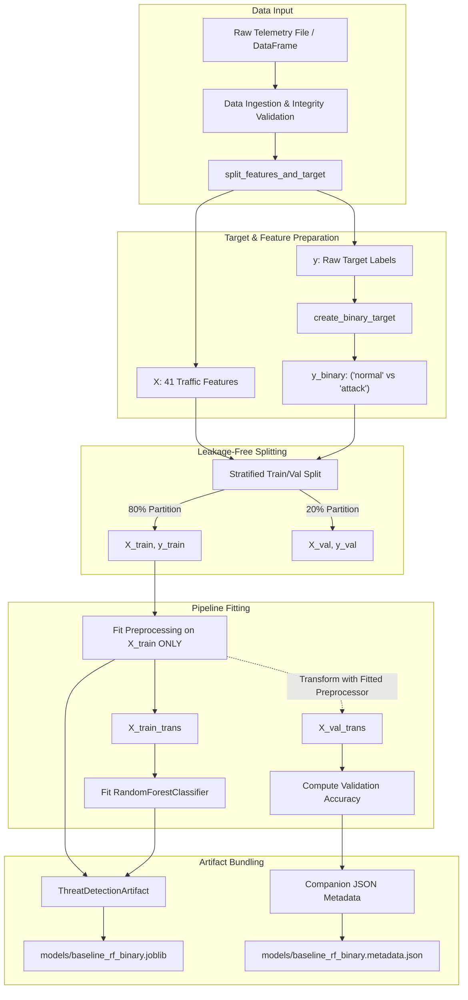

# 04. Model Training & Learning Mechanics

## 1. Overview & Baseline Formulation

The **AI-Powered Cybersecurity Threat Detection System** begins with a **reproducible binary classification baseline** utilizing Scikit-Learn's `RandomForestClassifier`.

### 1.1 Binary Classification Target Definition
- **Normal Telemetry**: `normal` $\rightarrow$ `normal`
- **Recognized Attack Telemetry**: Any catalogued attack label (DoS, Probe, R2L, U2R) $\rightarrow$ `attack`
- **Uncatalogued Labels**: Handled via explicit policy (`error` to reject anomalies or `attack` to treat as novel intrusions).

> [!NOTE]
> The Phase 4 model is a binary classifier. It discriminates between benign traffic and cyber threats with high accuracy, but does **not** categorize the specific attack vector (e.g. distinguishing DDoS from PortScan). Multi-class attack attribution and anomaly scoring are scheduled for Phase 5.

---

## 2. Reproducible Training Architecture



---

## 3. Data Leakage Prevention Boundary
1. **Split Prior to Transformation**: The train/validation split occurs **before** any preprocessor fitting.
2. **Strict Training Fit**: `ThreatPreprocessingPipeline.fit()` is called strictly on `X_train`. Target `y_train` is never passed into the preprocessor.
3. **No Target or Metadata Leakage**: Feature matrix `X` strictly contains the 41 canonical traffic features. Both `class` and `difficulty_level` are completely excluded.
4. **Validation Transform**: `X_val` is transformed using the already-fitted preprocessor without refitting or updating vocabulary statistics.

---

## 4. Hyperparameters & Configuration

The baseline utilizes documented, deterministic hyperparameters:

| Parameter | Value | Rationale |
| :--- | :--- | :--- |
| `n_estimators` | `100` | Ensemble stability and variance reduction across decision trees. |
| `max_depth` | `20` | Constrains tree depth to prevent overfitting on noisy network packet stats. |
| `min_samples_split` | `2` | Standard split threshold. |
| `min_samples_leaf` | `1` | Captures rare intrusion edge cases. |
| `class_weight` | `"balanced"` | Compensates for natural skew between benign traffic and attack samples. |
| `random_state` | `42` | Guarantees deterministic splitting and tree building. |
| `n_jobs` | `-1` | Parallelized multi-core training. |

---

## 5. Artifact Packaging & Loading

The trained model is encapsulated in a unified, self-contained container:
`ThreatDetectionArtifact`:
- Bundles the fitted `ThreatPreprocessingPipeline` alongside the fitted `RandomForestClassifier`.
- Guarantees future inference automatically applies the exact same categorical one-hot mappings and numerical feature alignments.
- Accompanied by a companion `.metadata.json` capturing row counts, feature dimensions, observed distributions, and library versions.

### 5.1 Programmatic Usage
```python
from threat_detection.detection import ThreatDetectionArtifact

# Load model bundle
model = ThreatDetectionArtifact.load("models/baseline_rf_binary.joblib")

# Inference directly on raw 41-feature DataFrame
predictions = model.predict(X_test)
probabilities = model.predict_proba(X_test)
```

### 5.2 Training CLI Command
```bash
# Train on local NSL-KDD dataset
python -m threat_detection.detection.train_cli data/raw/KDDTrain+.txt --output models/baseline_rf_binary.joblib

# Configure validation fraction and random seed
python -m threat_detection.detection.train_cli data/raw/KDDTrain+.txt --val-fraction 0.2 --seed 42
```

---

## 6. Distinguishing Test Verification from Real Dataset Training

- **Unit & Pipeline Tests**: Validated with small, self-contained synthetic fixtures in `tests/test_model_training.py` to confirm pipeline correctness, data integrity, and reproducibility without network overhead.
- **Real NSL-KDD Training**: Executed only when the genuine `KDDTrain+.txt` dataset file is provided locally by the user. If the file is absent, the system exits safely with a clear prerequisite message.
