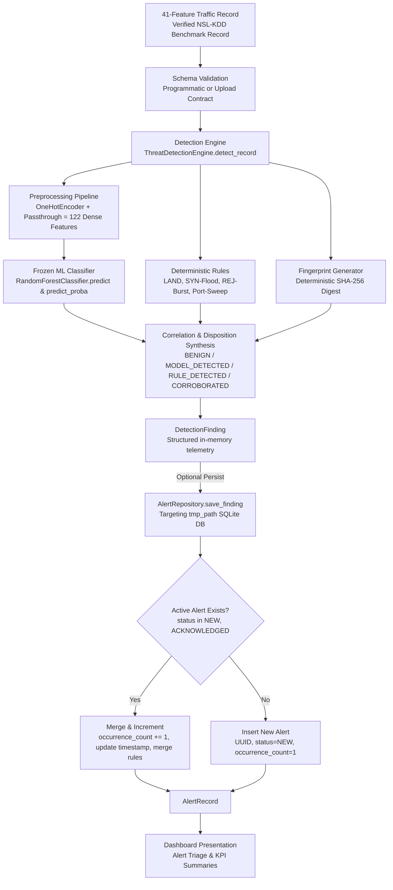

# Phase 9: End-to-End Integration and Testing
## Task 1: Integration Readiness Report & Test Plan (Revised)

**Document Version:** 1.1 (Revised) 
**Status:** Under Review (Task 1 Planning & Contracts Refinement — No application code modified) 
**Date:** 2026-10-13 
**Project:** AI-Powered Cybersecurity Threat Detection System (Educational & Defensive Portfolio)

---

### 1. Executive Summary & Project Constraints
This document provides an evidence-based integration assessment, explicit interface contract specifications, and an end-to-end integration-test plan for Phase 9 of the AI-Powered Cybersecurity Threat Detection System.

**Strict Scope & Educational Boundaries:**
* **Educational & Defensive Only:** Designed exclusively for offline threat detection research, benchmarking, and security operations triage demonstration.
* **No Live Monitoring Claimed:** Strictly evaluates static flow records and offline benchmark files; does not capture live network packets, monitor stream interfaces, or perform real-time blocking.
* **Frozen Model & Datasets Preserved:** The Random Forest binary classifier artifact (`models/baseline_rf_binary.joblib`) and NSL-KDD benchmark datasets (`data/raw/KDDTrain+.txt`, `data/raw/KDDTest+.txt`) are strictly frozen, verified by SHA-256 digests, and remain read-only. No retraining occurs.
* **Primary Database Isolation via `tmp_path`:** Integration tests that exercise persistence across multiple repository instances, connections, or dashboard reloads must use an isolated `tmp_path`-backed SQLite database path passed explicitly to `AlertRepository`. The default production database (`outputs/threat_events.db`) is never created, modified, or deleted during tests.

---

### 2. Files & Interfaces Inspected

| Subsystem / Layer | Source File / Module | Inspected Functions & Public Interfaces |
| :--- | :--- | :--- |
| **Data Schema & Taxonomy** | `src/threat_detection/data/schema.py` | `FEATURE_COLUMNS` (41 features), `NUMERICAL_FEATURES` (38 features), `CATEGORICAL_FEATURES` (3 features), `verify_feature_schema()` |
| **Data Ingestion** | `src/threat_detection/data/loader.py` | `load_nsl_kdd()` |
| **Data Validation** | `src/threat_detection/data/validator.py` | `validate_nsl_kdd()`, `ValidationReport` |
| **Preprocessing Pipeline** | `src/threat_detection/preprocessing/pipeline.py` | `validate_traffic_features()`, `create_nsl_kdd_preprocessor()`, `ThreatPreprocessingPipeline` (`fit`, `transform`, `get_feature_names_out`) |
| **Target Transformation** | `src/threat_detection/detection/target.py` | `create_binary_target()` |
| **Model Ingestion & Inference** | `src/threat_detection/detection/trainer.py` | `ThreatDetectionArtifact` (`load`, `predict`, `predict_proba`), `train_binary_model()` |
| **Evaluation Telemetry** | `src/threat_detection/detection/evaluator.py` | `evaluate_model()`, `compute_metrics_from_predictions()`, `EvaluationMetrics` |
| **Heuristic Security Rules** | `src/threat_detection/detection/rules.py` | `BaseSecurityRule`, `LandAttackRule`, `SynFloodHeuristicRule`, `ConnectionRejectionBurstRule`, `MultiServicePortSweepRule`, `create_default_security_rules()` |
| **Detection Engine** | `src/threat_detection/detection/engine.py` | `ThreatDetectionEngine` (`detect_record`, `detect_batch`, `detect`), `compute_record_fingerprint()`, `DetectionFinding`, `ModelDecision` |
| **Alert Storage Models** | `src/threat_detection/storage/models.py` | `AlertRecord`, `AlertStatus`, `SEVERITY_ORDER`, `InvalidLifecycleTransitionError`, `InvalidFindingError` |
| **Alert Repository** | `src/threat_detection/storage/repository.py` | `AlertRepository` (`initialize_schema`, `save_finding`, `save_findings_batch`, `get_alert_by_id`, `list_alerts`, `acknowledge_alert`, `resolve_alert`, `get_summary_counts`) |
| **Dashboard Helpers** | `dashboard/helpers.py` | `parse_and_validate_csv_upload()`, `resolve_database_path()`, `compute_kpis()`, `filter_alerts_on_page()`, `PRESET_FLOW_RECORDS`, `load_evaluation_metrics()`, `load_model_metadata()` |
| **Dashboard UI** | `dashboard/app.py` | `render_triage_tab()`, `render_demo_tab()`, `render_model_rules_tab()`, `get_repository()`, `get_detection_engine()` |
| **Application Entry Point** | `main.py` | `main()` (Foundation status banner) |
| **Configuration** | `src/threat_detection/config.py`, `pyproject.toml` | `config.ProjectConfig` |

---

### 3. Detailed Input Validation Contracts

Inspection of the actual implementation reveals two distinct, purposefully scoped validation contracts operating at different architectural boundaries:

#### A. Programmatic Feature Contract: `validate_traffic_features(X: pd.DataFrame)`
* **Location:** `src/threat_detection/preprocessing/pipeline.py`
* **Architectural Scope:** Internal programmatic validation boundary used by `ThreatPreprocessingPipeline` (`fit`, `transform`) and `ThreatDetectionEngine` (`detect_batch`).
* **Input Type:** `pd.DataFrame`.
* **Contract Specification:**
  1. **Label Leakage Protection:** Explicitly checks for ground-truth label columns (`LABEL_COLUMN = "class"`) and benchmark difficulty metadata (`DIFFICULTY_COLUMN = "difficulty_level"`). If either is present, raises `ValueError` immediately to prevent data leakage into model inference.
  2. **Required Features Coverage:** Checks that all 41 canonical features in `FEATURE_COLUMNS` are present. If any are missing, raises `ValueError` detailing the missing fields.
  3. **Numerical Type Integrity:** Iterates over all 38 numerical features in `NUMERICAL_FEATURES`. If a column is stored as `object` or string dtype, attempts `pd.to_numeric(series, errors='coerce')` and raises `ValueError` if non-numeric values are detected, preventing silent coercion or unhandled NaNs.
  4. **Arbitrary Extra Columns Policy (Permissive Passthrough):** Does **not** reject arbitrary non-metadata extra columns (e.g., `client_ip`, `flow_id`, or `capture_timestamp`). In both the preprocessor and detection engine, `X` is explicitly sliced to `FEATURE_COLUMNS` (`X[FEATURE_COLUMNS]` / `records[FEATURE_COLUMNS].copy()`), safely discarding extra columns. This design allows dataframes carrying external identifiers or routing metadata to flow through programmatic Python APIs without requiring callers to strip auxiliary columns manually.

#### B. User-Facing File Upload Contract: `parse_and_validate_csv_upload(file_input: Union[bytes, str])`
* **Location:** `dashboard/helpers.py`
* **Architectural Scope:** External untrusted input boundary for the Streamlit demonstration tab.
* **Input Type:** Raw bytes or decoded string of an uploaded CSV file.
* **Contract Specification:**
  1. **File & Row Count Enforcement:** Rejects empty files/strings (`ValueError`). Parses CSV via `io.StringIO` and strictly enforces exactly one data row (`len(df) == 1`). Rejects 0-row and multi-row files (>1 row) with `ValueError`.
  2. **Strict Schema Whitelist (Zero Unexpected Columns):** Verifies that `set(df.columns) == set(FEATURE_COLUMNS)`. Rejects missing required columns with `ValueError`. Crucially, rejects **any** unexpected column—including `class`, `difficulty_level`, and any arbitrary extra column (`col_extra`)—with a clear `ValueError`.
  3. **Delegation to Numerical Validation:** Slices `df[FEATURE_COLUMNS]` and invokes `validate_traffic_features()` to enforce strict numerical type validity on all 38 numerical features.
  4. **Output:** Returns a validated dictionary mapping the 41 canonical feature names to their parsed values for the single flow record.

#### Architectural Rationale for Contract Difference
The two interfaces serve fundamentally different contexts:
* The CSV upload helper is an untrusted user boundary where users might mistakenly upload an entire raw benchmark test file (containing target `class` and `difficulty_level`) or a corrupted multi-column CSV. A strict schema whitelist protects the interactive demo against ambiguity.
* The programmatic engine and pipeline accept dataframes in Python code where auxiliary tracking columns are common. Permitting extra columns (while strictly barring `class` and `difficulty_level`) prevents brittle API failures while guaranteeing that model inference receives only the 41 verified features.

---

### 4. Database Isolation Architecture

To ensure tests never compromise or pollute persistent storage, the integration testing architecture enforces strict database isolation:

1. **Explicit `tmp_path`-Backed Databases for Multi-Connection / Persistence Tests:**
   * SQLite's default in-memory database (`:memory:`) creates a distinct, private database per connection. While `AlertRepository` holds a single connection open for `:memory:` on a single instance, tests that instantiate multiple repository objects (e.g., verifying multi-client access, repository re-initialization, or dashboard data reloading via `resolve_database_path()`) cannot share state across independent `:memory:` connections without URI mode flags (`file:memdb?mode=memory&cache=shared`).
   * Therefore, all end-to-end integration tests requiring multi-connection persistence, lifecycle transitions across instances, or dashboard helper interactions **must** use a dedicated SQLite file created within pytest's isolated `tmp_path` fixture (e.g., `tmp_path / "test_threat_events.db"`).
2. **Explicit Dependency Injection & Environment Override:**
   * The isolated `tmp_path` database is passed directly to `AlertRepository(db_path=isolated_path)`.
   * For dashboard tests exercising `resolve_database_path()`, `os.environ["THREAT_DETECTION_DB_PATH"] = str(isolated_path)` is set and cleaned up via pytest fixture teardown.
3. **Protection of Default Database (`outputs/threat_events.db`):**
   * The production default database path (`config.DATABASE_PATH`) is never used during automated testing.
   * Tests will never create, update, or delete `outputs/threat_events.db`.
   * An automated assertion verifying that `outputs/threat_events.db` does not exist before and after test runs serves as a local safety sanity observation.

---

### 5. Intended End-to-End Data Flow

The end-to-end workflow connects six primary layers:

---

### 6. Ten-Scenario End-to-End Integration-Test Plan

The integration test suite (`tests/test_integration_e2e.py`) will implement the ten focused integration scenarios. Each scenario is verified against authentic NSL-KDD records and real model decisions rather than preset labels alone:

#### Scenario 1: Benign Record Through Full Pipeline
* **Setup:** Instantiate `ThreatDetectionEngine` with frozen artifact. Obtain authentic verified normal record from `data/raw/KDDTest+.txt` Row 2 (`Normal FTP session`: `duration=2`, `protocol_type='tcp'`, `service='ftp_data'`, `flag='SF'`, `src_bytes=12983`, `dst_bytes=0`, `count=1`, `srv_count=1`, `serror_rate=0.0`, `land=0`).
* **Action:** Pass record through `engine.detect_record()`.
* **Expected Result:**
  * Preprocessing transforms 41 features to 122 dense features.
  * Model predicts label `"normal"`, attack probability $\le 0.05$.
  * 0 deterministic security rules match (`rule_matches == []`).
  * Telemetry synthesizes `disposition="BENIGN"`, `overall_severity="INFORMATIONAL"`, `threat_detected=False`.
  * Deterministic 64-character SHA-256 fingerprint generated.
* **Coverage Analysis:** Unit tests verify rule checks in isolation; **New E2E test** validates the full end-to-end data flow from raw 41-feature dictionary through model inference, correlation synthesis, and structured finding generation.

#### Scenario 2: Corroborated Attack Record Through Pipeline & Rules
* **Setup:** Obtain authentic verified attack record from `data/raw/KDDTest+.txt` Row 13 (`neptune` SYN flood: `protocol_type='tcp'`, `service='telnet'`, `flag='S0'`, `count=120`, `srv_count=120`, `serror_rate=1.0`, `srv_serror_rate=1.0`).
* **Action:** Pass record through `engine.detect_record()`.
* **Expected Result:**
  * Model predicts label `"attack"`, attack probability $\ge 0.95$.
  * `SynFloodHeuristicRule` (`RULE-DOS-SYN-001`, severity `MEDIUM`) matches (`count=120 >= 100`, `serror_rate=1.0 >= 0.80`, `flag='S0'`).
  * Correlation synthesizes `disposition="CORROBORATED"`, `overall_severity="HIGH"`, `threat_detected=True`.
* **Coverage Analysis:** Existing unit tests test rules and classifier separately; **New E2E test** validates multi-layer corroboration and severity synthesis on authentic NSL-KDD telemetry.

#### Scenario 3: Strict Input Rejection & Boundary Defense
* **Setup:** Construct four distinct invalid records:
  1. *Missing feature:* Record omitting `dst_bytes`.
  2. *Invalid numerical type:* Record with `src_bytes="not_a_number"`.
  3. *Label leakage:* DataFrame containing target label `class="normal"`.
  4. *Strict CSV upload schema violation:* CSV containing extra column `arbitrary_tag="test"`.
* **Action:**
  * Submit cases 1, 2, 3 to `validate_traffic_features()` and `engine.detect_record()`.
  * Submit case 4 to `parse_and_validate_csv_upload()`.
* **Expected Result:**
  * Cases 1, 2, 3 raise `ValueError` with descriptive message; zero model inference occurs.
  * Case 4 raises `ValueError` ("Uploaded CSV contains unexpected column(s)"); upload is rejected.
* **Coverage Analysis:** Unit tests check isolated functions; **New E2E test** systematically verifies input boundaries against leakage and malformed data across both ingestion interfaces.

#### Scenario 4: Finding Persistence & Roundtrip Retrieval in Isolated DB
* **Setup:** Create a fresh SQLite database at `tmp_path / "e2e_storage.db"`. Initialize schema via `AlertRepository(db_path=...)`. Execute Scenario 2 to obtain an authentic `DetectionFinding`.
* **Action:** Call `repo.save_finding(finding)`. Using a *new* `AlertRepository` connection instance to the same `tmp_path` DB, call `repo.get_alert_by_id(saved.alert_id)`.
* **Expected Result:**
  * Saved alert returned with UUID `alert_id`, `status="NEW"`, `occurrence_count=1`.
  * Retrieved `AlertRecord` across independent connection matches fingerprint, disposition (`CORROBORATED`), severity (`HIGH`), attack probability, and serialized rule matches (`RULE-DOS-SYN-001`).
* **Coverage Analysis:** `test_alert_storage.py` tests repository with synthetic mock findings; **New E2E test** validates roundtrip directly using findings produced by the real `ThreatDetectionEngine` on an authentic benchmark attack.

#### Scenario 5: Duplicate Finding Deduplication & Occurrence Increment
* **Setup:** Using `tmp_path`-backed repository from Scenario 4 (containing active alert from Scenario 2 with `occurrence_count=1`).
* **Action:** Re-evaluate the identical attack record with `engine.detect_record()` and persist via `repo.save_finding(finding_2)`.
* **Expected Result:**
  * Active duplicate detected by 64-char fingerprint partial index.
  * Existing alert updated: same `alert_id`, `occurrence_count=2`, `status="NEW"`.
  * `last_seen_timestamp` updated to latest finding timestamp; `first_seen_timestamp` preserved.
  * Total rows in database remains exactly 1.
* **Coverage Analysis:** Storage unit tests test synthetic fingerprints; **New E2E test** proves deterministic fingerprinting across repeated engine runs seamlessly merges findings without record explosion.

#### Scenario 6: Alert Lifecycle State Machine & Invalid Transitions
* **Setup:** Using active `NEW` alert from Scenario 5 in `tmp_path` DB.
* **Action:**
  1. Attempt direct resolution: `repo.resolve_alert(alert_id)`.
  2. Perform valid acknowledgement: `repo.acknowledge_alert(alert_id, analyst_notes="Investigating")`.
  3. Attempt duplicate acknowledgement: `repo.acknowledge_alert(alert_id, analyst_notes="Updated notes")`.
  4. Perform resolution: `repo.resolve_alert(alert_id, analyst_notes="Resolved benign")`.
* **Expected Result:**
  1. Step 1 raises `InvalidLifecycleTransitionError` ("Cannot resolve alert ... directly from 'NEW' status").
  2. Step 2 transitions status to `"ACKNOWLEDGED"`, records `acknowledged_at`.
  3. Step 3 succeeds idempotently, preserving original `acknowledged_at`.
  4. Step 4 transitions status to `"RESOLVED"`, records `resolved_at`.
* **Coverage Analysis:** Tested on synthetic data; **New E2E test** asserts lifecycle integrity on an alert generated from genuine end-to-end model detection.

#### Scenario 7: Dashboard Interaction with Stored Alerts
* **Setup:** Populate `tmp_path` DB with 3 real alerts: 1 `NEW` (corroborated), 1 `ACKNOWLEDGED` (model-detected), 1 `RESOLVED` (benign). Set `THREAT_DETECTION_DB_PATH` to `tmp_path` DB.
* **Action:**
  1. Execute `resolve_database_path()`.
  2. Query `repo.get_summary_counts()` and compute KPIs via `compute_kpis()`.
  3. Query `repo.list_alerts(status="NEW")`.
  4. Apply `filter_alerts_on_page(alerts, search_query="neptune")`.
* **Expected Result:**
  * `resolve_database_path()` returns `tmp_path` database.
  * KPI summary accurately computes `total=3`, `new=1`, `acknowledged=1`, `resolved=1`, `high_critical=1`.
  * Filter returns only the `NEW` alert.
  * Search matches expected alert by explanation/narrative text.
* **Coverage Analysis:** `test_dashboard.py` tests dashboard helpers with synthetic rows; **New E2E test** validates that dashboard aggregation utilities accurately parse alerts written by the detection engine.

#### Scenario 8: Truthful Error Reporting & Fault Tolerance
* **Setup:** Configure three distinct fault conditions:
  1. *Model missing:* Nonexistent artifact path passed to `ThreatDetectionArtifact.load()`.
  2. *Metrics missing:* Nonexistent metrics JSON passed to `load_evaluation_metrics()`.
  3. *Unregistered alert lookup:* Nonexistent UUID passed to `repo.get_alert_by_id()`.
* **Action:** Execute respective loading/query methods.
* **Expected Result:**
  1. Raises explicit `FileNotFoundError` (no silent placeholder model created).
  2. Returns structured `{"status": "missing", "data": None, "error": ...}`.
  3. Returns `None` gracefully without crashing.
* **Coverage Analysis:** Unit tests check some error paths; **New E2E test** verifies system-wide truthful reporting standards across core subsystems.

#### Scenario 9: Protection of Frozen Model & Dataset Artifacts
* **Setup:** Record SHA-256 hashes of `models/baseline_rf_binary.joblib`, `data/raw/KDDTrain+.txt`, and `data/raw/KDDTest+.txt`.
* **Action:** Execute the complete end-to-end integration test suite (Scenarios 1 through 8).
* **Expected Result:**
  * Model SHA-256 matches `0E364EA84FA5F35BA1CE2FF025235ED70B0BEE9423611C354CE520F69E60F6C5`.
  * Training data SHA-256 matches `1B86D2F957B33082081BBA410FE129B475EFEBCC13C9014C3F447C8271AADF95`.
  * Test data SHA-256 matches `FA46B0935342616AA83B7C2578DB355B6A7AAABBC492248172C7A1E8B7AB8F84`.
  * File modification timestamps remain unmodified; no retraining or overwrite executed.
* **Coverage Analysis:** Previously verified via ad-hoc terminal checks; **New automated test fixture** programmatically enforces artifact immutability.

#### Scenario 10: Default Database Isolation Safety Observation
* **Setup:** Verify `outputs/threat_events.db` before test execution.
* **Action:** Run the entire test suite.
* **Expected Result:**
  * `outputs/threat_events.db` does not exist prior to testing.
  * `outputs/threat_events.db` does not exist following testing.
  * All integration persistence executes strictly inside isolated `tmp_path` fixtures.
* **Coverage Analysis:** Verified manually; **New automated safety assertion** checks that default database path was never created or touched.

---

### 7. Baseline Test Suite Status & Checksums

* **Test Suite Command:** `.\.venv\Scripts\python.exe -m pytest -v`
* **Exit Code:** `0`
* **Total Collected Tests:** 145 passed in 22.93s (0 failures, 0 warnings)
* **Git Status (`git status --short`):** Untracked files present; 0 modified application files; zero commits yet on branch `main`.
* **SHA-256 Checksums:**
  * `models/baseline_rf_binary.joblib`: `0E364EA84FA5F35BA1CE2FF025235ED70B0BEE9423611C354CE520F69E60F6C5`
  * `data/raw/KDDTrain+.txt`: `1B86D2F957B33082081BBA410FE129B475EFEBCC13C9014C3F447C8271AADF95`
  * `data/raw/KDDTest+.txt`: `FA46B0935342616AA83B7C2578DB355B6A7AAABBC492248172C7A1E8B7AB8F84`
* **Default Database Isolation:** `outputs/threat_events.db` confirmed non-existent (`Test-Path` returned `False`).

---

### 8. Recommended Next Task
With the input validation contracts clarified and database isolation explicitly structured around `tmp_path`, proceed to **Phase 9, Task 2**: Implement the dedicated end-to-end integration test suite in `tests/test_integration_e2e.py`.
